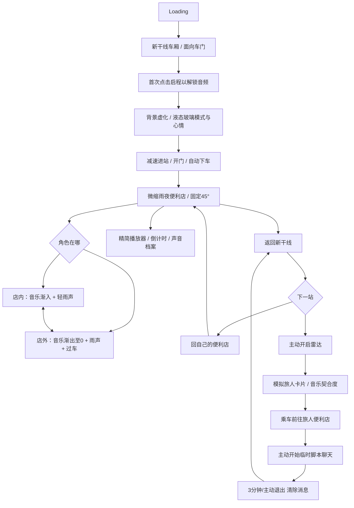

# Soundscape Railway — 完整产品需求文档（PRD v1.0）

> 更新：2026-10-09｜个人作品集｜移动端网页 / PWA｜实施者：Codex  
> 此文件为产品要求的第一依据。辅助文档：`ARCHITECTURE.md`、`TASKS.md`、`DESIGN_SYSTEM.md`、`TEST_PLAN.md`、`DECISIONS.md`。  
> 核心叙事：**乘新干线抵达每个人的声音空间，在雨夜便利店里听音乐，离开后只剩雨声，主动乘车才能遇见另一位旅人。**

## 1. 产品范围与不可变约束

1. **个人作品集**，不计划商业化；展示设计、前端架构、音频、3D、交互和本地数据能力。
2. 首选手机 Safari/Chrome，构建可安装的 PWA；静态托管可用（GitHub Pages），**没有自己的后端、云数据库和账号**。首次获取资源仍需网络，缓存之后部分可离线。
3. 所有核心业务在用户浏览器运行；IndexedDB 是唯一的本地业务数据源；没有 AI 推理或云 AI。默认无需账户、不连接云服务；后续仅允许用户主动开启第三方存储同步，不建立项目账户、自建后端或云数据库。
4. 不使用原生锁屏、系统熄屏显示、原生 App 或微信小程序。
5. **放弃早期第三人称开放世界和俯瞰大地图方案**；最终场景是一个固定约 **45° 斜上俯视镜头**的可探索方形底座微缩便利店。点按地面移动微缩角色；镜头固定不旋转。
6. 旅人和聊天均为**本地模拟数据**，必须明显标注；无后端无法自动发现实时陌生人或提供真正的多人聊天。
7. 音乐使用已授权可分发演示曲目、用户导入本地音乐，以及 Web Audio 本地生成白噪音。第一版不抓取网易云/Spotify 的完整受限制曲库。
8. 美术目标参考 `references/store_concept.png`；液态玻璃动效参考 `references/liquid_glass_reference.mp4`。二维概念图并不是可操作的 GLB 资产。

## 2. 用户体验总流程

### 2.1 Loading 和首次声音权限

- Loading 需要显示真实的资源加载状态或阶段，不能虚构完成百分比；失败可重试。
- 用户首先出现在行驶中的新干线车厢内，面对车门。窗外风景流动，车厢轻微振动、暖色灯光柔和。
- 浏览器通常要求用户手势才可有声播放。以一次清晰的「启程」点击解锁 Web Audio；没有授权时仅呈现静音动画。
- 车厢底噪低音量、持续柔和、不打断用户；选择模式后列车自动减速进站。
- 每次打开仍展示模式弹窗，但可预选上次的模式和心情，减少交互负担。

### 2.2 模式和心情（分开建模）

| 场景 mode | 中文 | 推荐方向 | 默认定时（可改） | 交友 |
|---|---|---|---|---|
| `focus` | 专注/工作 | 器乐、Ambient、轻 Lo-Fi | 25 分钟 | 禁止 |
| `sleep` | 睡眠 | 雨声、柔和环境音、低刺激音乐 | 30 分钟 | 禁止 |
| `relax` | 放松 | 按情绪筛选氛围音乐 | 可选 | 可主动开启 |
| `free` | 自由 | 更丰富、适度探索的歌单 | 可选 | 可主动开启 |

心情 mood：`calm` 平静、`happy` 愉悦、`tired` 疲惫、`anxious` 焦虑、`lonely` 孤独。心情是主动自报，不做心理诊断、人格判断。

`doNotDisturb` 勿扰是独立开关：不改变音乐类别，但强制禁用雷达/聊天。社交禁用由统一业务权限函数保障，不是简单隐藏按钮。

### 2.3 到站 / 45° 微缩场景

- 列车停稳，车门打开，角色自动下车。镜头过渡上摇，最终固定在约 45° 斜上俯视；优先正交相机形成微缩模型感。
- 方形底座上展示日式三渲二雨夜街角便利店。门、灯箱、透明玻璃窗、室内货架、关东煮、冰柜、收银台等内部设施可见。
- 屋外雨夜：冷蓝光、雨丝、屋檐滴水、积水涟漪、湿路反光、窗上雨痕、灯箱细微闪烁、偶尔远处列车驶过；店内暖光充实。
- 玩家以**点击地面**方式行走，靠近自动玻璃门时门打开。进入店内时屋顶/遮挡墙做淡出或剖视，保证固定镜头仍能看到室内；出店时恢复。
- **空间声音规则是最重要的核心需求：进店音乐渐入，出店音乐渐至静音，仅保留天气与随机过车声。**
- 新干线、便利店、旅人车站不需要属于同一连续 3D 大世界；可作为独立场景加载，并通过镜头与音效过场衔接。

## 3. 主要功能 A：音频播放器与空间音景

### 3.1 音频引擎原则

全局单一音频引擎，不因 React 弹窗或场景重新挂载而重置；独立通道：`master / music / rain / train / effects`，使用 Web Audio `GainNode` 和音量 ramp 混合。

| 位置 zone | 主音乐 | 天气声 | 列车声 |
|---|---|---|---|
| 新干线车厢 | 用户可选打开/继续 | 极低/无 | 柔和持续行驶声 |
| 便利店外 | 渐至 **0**，保留播放进度 | 主要声源 | 随机远处列车通过 |
| 门槛过渡区 | 根据位置平滑交叉淡变 | 逐渐变化 | 远处削弱 |
| 便利店内 | 主音乐清晰 | 弱化与适度滤波 | 极弱/无 |

- 从店内走到店外，不是暂停或从头重播音乐，而是把 music 通道渐变到 0；返回店内恢复可听；用户主动暂停除外。
- 使用玩家所在空间坐标检测 zone，**不能用固定摄像机位置决定声音**。门槛使用滞回阈值，防止反复跳变。
- 过车音效设最短间隔并随机调度，逐渐接近/远离、轻声掠过；睡眠模式可取消过车。
- 音量参数分为「用户主观音量 × 区域音量 × 总音量」，避免相互覆盖；切换曲目避免双主音轨同时播放。
- 场景隐藏可暂停视觉渲染，但音频/定时独立管理；iOS 背景播放行为不可保证。

### 3.2 曲库与标签推荐（无 AI）

- 仅使用项目自带的有许可/可再分发音频、自合成白噪音/粉红噪音以及用户导入曲目。资源许可必须登记。
- 曲目字段：`id, title, artist?, source, tags, eligibleModes, moodTags, energy(0..1), instrumental, duration, assetPath`。
- 推荐步骤：按 mode **硬过滤** → 根据心情、用户偏好、歌曲新鲜度计分 → 带权随机采样 → 近期歌曲去重。
- 初始示意：`score = 0.45*moodMatch + 0.30*preferenceMatch + 0.25*novelty`，各分量 0–1，可配置权重。
- 无候选音轨时：提示用户导入音乐或退回环境音，不发送未经授权的在线抓取请求。
- 用户本地音频导入需处理 Blob 体积和浏览器存储容量；若仅临时引用文件，明确说明刷新后需要重新导入。

### 3.3 播放控件

- 常态无庞大 UI；轻触/点击才显示液态玻璃音乐 HUD。
- 功能：播放/暂停、下一曲、喜欢/跳过、当前曲目信息、音乐/环境独立音量、计时器、声音档案、返回列车。
- 定时器支持 15/25/30/45/60 分钟或自定义；结束可选「关闭音乐」或「淡出全部声音」。
- 计时使用绝对 `expiresAt`，恢复前台时重新校正；不能承诺锁屏瞬时停止。

## 4. 主要功能 B：声音档案（周/月/年）

### 4.1 本地保存

IndexedDB 保存：用户设置、播放会话、有效时长、音轨喜欢/跳过、访问车站事件、导入音轨元数据、可重建的偏好统计与车站配置。默认数据不上传；可选第三方同步的范围见 4.3。

- 会话记录：开始/结束 UTC 时间、mode、mood、stationId、有效可听音乐时长、有效环境声时长、是否完成；防止重复写入或刷新重复计时。
- **不要把打开页面的秒数等同于真实可听时长**；在被静音、暂停和长时间后台时按照明确的统计规则处理。
- 周：最近 7 天；月：自然月日历方块；年：包含闰年情况的全年 GitHub 式热力图，每日格子可点开。
- 深浅颜色优先代表当天有效时长，不使用颜色判断情绪好坏。
- 详情：当天模式分布、心情、音乐标签、时间线、累计时长、最常听类型。
- 必须提供空状态，而不是生成假历史统计。

### 4.2 数据可控

- M4 实现声音档案版本化 JSON 导出和导入；导入前校验结构和大小，展示合并与冲突预览并由用户确认；重复导入不得重复计时。清空档案和缓存属于独立的用户主动操作，不把备份或同步文件当作全库覆盖依据。
- 告知浏览器缓存可能被清理，备份由用户掌握；只读演示访客不能假装数据云同步。
- **聊天消息不写入 IndexedDB 或 localStorage**。

### 4.3 本地优先的跨设备声音档案同步（后续可选）

- M4 先完成手动 JSON 跨设备导入/导出与稳定 ID，不实现云同步。云同步后续另行评估、授权和排期，不能阻塞 M1 便利店与室内外音频系统的完善和验收。
- 所有参与同步的会话、播放/喜欢/跳过事件、访问事件及其他业务记录必须有稳定唯一 ID；跨设备导入、迁移及重试保留原 ID，避免重复计数。统计由合并后的原始记录重建，不累加两份统计快照。
- 后续通过 `SyncProvider` 接口接入 Dropbox、WebDAV 等适配器；远端文件只是交换/备份载体，所有业务读写仍经 IndexedDB。
- 优先评估 Dropbox 官方 JavaScript SDK、OAuth 2.0 PKCE 和 App Folder 最小权限；WebDAV 为高级选项，接入前必须检查 HTTPS、身份验证及 CORS 兼容性。
- 同步采用事件合并、ID 去重和明确的冲突处理；不得直接以最后上传的文件覆盖全部历史。同 ID 不同内容、并发修改和删除冲突须可识别，不能静默丢失历史。
- 同步白名单只包含声音档案所需业务记录及允许的元数据；不包含用户本地音乐文件、临时聊天消息、授权令牌或其他连接凭据。
- 云同步默认关闭，由用户主动选择服务并授权。开启前说明同步字段、第三方存储与访问的隐私边界、撤销授权及断开方式；断开不等于删除第三方已存文件，删除需明确操作。
- 后续评估使用 Web Crypto API 对同步文件进行客户端加密，包括跨设备密钥管理与丢失后的恢复边界；当前不承诺已加密。
- 云同步只保证网页运行期间的适时同步；网络或授权失败保留本地记录并提示待重试，不承诺浏览器关闭后的持续后台同步。

## 5. 主要功能 C：雷达、旅人车站和临时聊天

### 5.1 社交入口时机

- 仅在**返回新干线之后**提供雷达入口；第一次打开以及在便利店聆听时不强制弹社交窗口。
- 专注、睡眠、勿扰状态：禁止雷达、匹配、用户卡及聊天，包括通过程序状态绕过的情况。
- 放松与自由：允许主动点击雷达，默认不自动启动匹配；用户关闭后不持续弹窗。

### 5.2 模拟匹配

- 内置 3 名以上虚拟旅人，例如 `Rin`（雨夜 Ambient）、`Haru`（海边黄昏 City Pop）、`Yuki`（雪夜钢琴）；统一 `demo: true`。
- 匹配依据：`0.55*音乐标签 + 0.25*模式偏好 + 0.15*活跃时间重合 + 0.05*当前心情`；归一化、数据不足时说明。
- 称为「音乐契合度」或「生活节奏相似」，**不是人格/性格相似度**。
- 雷达是列车上的选站仪式：显示模拟旅人、声音标签、目标车站。由用户主动点击「前往」触发列车旅程。

### 5.3 旅人便利店

- 车站组件复用一个或多个基础便利店模板，用天气、音频、贴图、灯光和局部陈设区分；不是新建庞大世界。
- 抵达后可欣赏微缩模型和旅人音乐，触碰旅人交互点后先出现身份卡，再由用户确认进入聊天。
- 必须有清晰的「返回列车」入口；离开旅人车站要清理聊天会话。
- 后期可增添导出/导入 `StationConfig` JSON，实现离线交换声音空间；这是可选增强，不是实时在线发现。

### 5.4 临时聊天

- React DOM 叠加在 Three.js 画布之上，以液态玻璃 UI 显示身份卡和聊天面板，背景保留旅人便利店。
- 旅人简介卡：模拟标识、昵称、音乐标签、匹配依据、开启聊天按钮。
- 聊天基于**预置分支剧本**，而非 AI 或真实即时消息。优先用 2–3 个可选回复；若提供自由输入，只能显示明确规则回复，不得声称理解任意文本。
- 默认限时 3 分钟，可主动退出。过期、退出、离站或切换到禁止模式时**立即清空消息内存**，并让玻璃面板收缩、消散；不得存档聊天文本。
- 手机软键盘、底部安全区、关闭手势、焦点恢复与 reduced-motion 必须考虑。

## 6. 视觉、动画与场景细节

- **模式弹窗**：借鉴苹果控制中心的液态磨砂玻璃（柔和模糊、透背景、胶囊圆角、边缘高光、弹簧形变），但不需要系统级真正光学折射。
- **雨夜便利店**：方形底座、紧凑日式三渲二、暖室内和冷屋外；商品货架、关东煮、冰柜、雨痕、水坑涟漪、屋檐滴落、灯箱微闪、柔和列车经过。
- **运镜**：车厢近景 → 列车停站、自动下车 → 镜头上摇到固定 45°；站点内不自由拖拽旋转相机。
- **帧率目标**：优先真机稳定 30fps，优化后争取 60fps。分级画质控制 DPR、雨粒、阴影和高级玻璃成本。
- 动态视觉应保证阅读/交互可用，支持 `prefers-reduced-motion`。
- 液态玻璃和聊天放在 DOM 层；Three.js 负责环境、模型、粒子和角色。

## 7. PWA、隐私与可靠性

- 静态部署 + Service Worker，版本化缓存必要资源；首次在线获取，下载过资源后提供明确的离线支持范围。
- 个人数据本地存储不保证永不被浏览器清理；JSON 备份、存储空间不足提示和清理流程必备。
- 不打包 API Key、客户端密钥或授权令牌；不引入项目账户认证或隐式埋点/分析服务。后续第三方存储授权仅用于用户主动开启的同步，遵守 4.3 的隐私边界。
- 音频浏览器权限与后台锁屏的限制需要诚实呈现；不假装可以控制系统屏幕。
- 若 WebGL 不支持或初始化失败，展示可理解的降级页面与重试控件。

## 8. 明确排除项

- 旧版第三人称开放世界角色探索、俯瞰式世界地图、常态可自由旋转底座。
- 未经授权的网易云/Spotify 全曲库播放与抓取；不实施付费平台绕过。
- 真实用户发现、实时陌生人聊天、项目账号与自建后台、AI 推荐/AI 聊天、系统熄屏显示。可选第三方存储同步不扩展为云端社交或云数据库。
- 用二维参考图冒充 3D 模型；缺正式模型就用程序化占位并如实说明。

## 9. 项目最终体验验收

访客可以：加载 → 点击启程 → 液态玻璃选择 → 列车进站 → 45° 雨夜便利店 → 点击进店音乐渐入 → 出店音乐淡去只剩雨声 → 播放器与计时 → 形成真实本地热力记录 → 返回列车 → 在允许模式下主动雷达 → 去模拟旅人便利店 → 3 分钟脚本聊天 → 消失并返回列车。

交付物：可静态部署的 PWA、GitHub 源码、部署步骤、模型/音效来源表、架构文档、测试、演示视频及已知限制。
